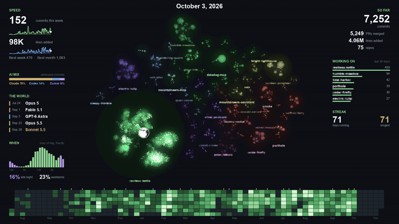

# Code Islands



```text
/plugin marketplace add dreamiurg/code-islands
/plugin install code-islands@code-islands
```

Turn your commits across every repo into a video. Each repo is a separate floating island that appears when you start it and grows as you work, with a live HUD of your speed, streaks, AI mix and the model releases happening around you.

[](https://youtu.be/9C3tzDGUd-c)

Why islands? Gource draws one connected tree, which works for a single repo. Separate projects are not connected, so here they float apart.

This is a starting point to play with, not a finished product. Fork it and make it yours.

## Use it

After installing, ask Claude Code something like "make a video of my last year of commits". It asks for a start date and length, shows your repos so you can leave some out, and renders.

## Needs

macOS or Linux, `git`, `ffmpeg`, the GitHub CLI signed in (`gh auth login`), and Python 3.9+ with `pillow` and `numpy`. `tesseract` is optional and powers the leak scan.

For sound, bring any audio file, from your library or any AI music tool. Without one the video is silent.

## What you get

- **Full cut:** every repo named, for you.
- **Share cut:** private repos show a blurred fake name, so de-blurring reveals nothing. Public repos keep their names. A scan reads the finished video and fails if a private name shows up.

Both come at 1080p and 720p. Your history stays on your machine. The scripts talk only to GitHub, and clones and data live in a local workspace. Claude also searches the web for recent AI model releases.

## Test

```sh
sh tests/smoke.sh
```

Builds two throwaway repos, renders both cuts, and checks that the private name stays out of the share cut.

## License

MIT
